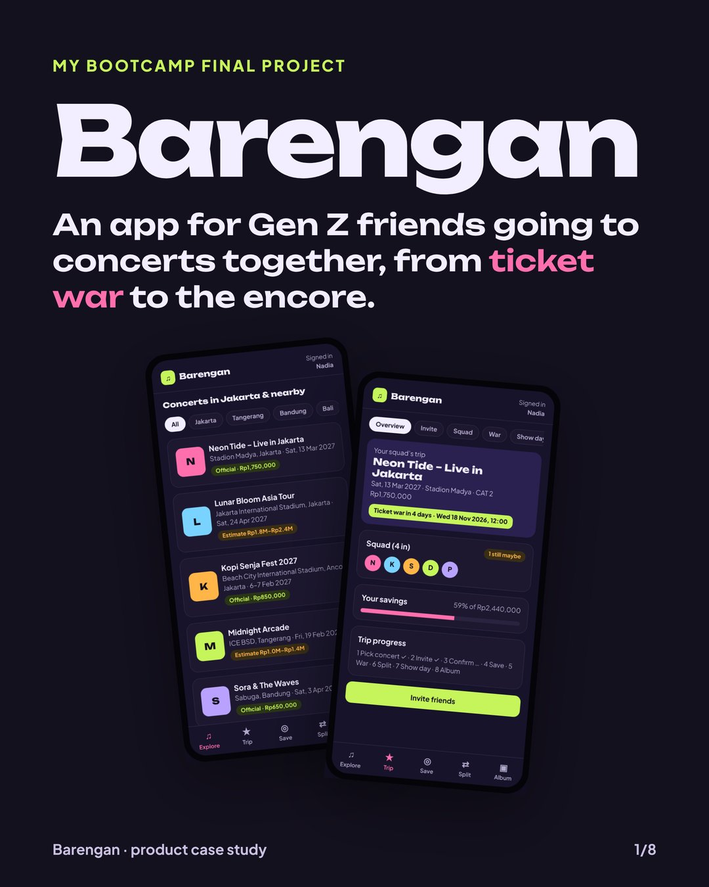

# Barengan 🎶

**A planner for friends going to concerts together, from ticket war to the encore.**

👉 **[View the case study](https://jennagozalii.github.io/barengan/)** · **[Try the clickable prototype](https://jennagozalii.github.io/barengan/prototype/)**



## The problem
Every friend group has one "admin". She asks who's in for weeks, chases everyone to save, runs the ticket war in a panicking group chat, pays for the hotel first, then spends weeks asking for the money back.

Ticket apps sell to one buyer, and split-bill apps only start after the money is spent. Nothing plans the group before the ticket sale opens.

## What Barengan does
1. **Explore**: concerts in Jakarta and nearby cities, or a manual trip
2. **Invite**: one link, code or QR; forwarded links need admin approval
3. **Confirm**: friends see the cost per person and tap "I'm in"
4. **Save**: a private target that starts from an estimated price and updates when the official price is out, with a price history log
5. **Ticket war**: who's on which account and device, and a "pay first, then we buy" rule
6. **Split**: automatic split, reminders sent by the app, and a step-by-step plan if someone never pays
7. **Show day**: meeting point and checklist
8. **Album**: one shared album and one memory link after the show

## My role
Solo project for the Business Analyst & Product Strategy Bootcamp at dibimbing.id (November 2026). I did the problem framing, market sizing, value proposition, BPMN process maps, OKRs and metrics, research design, RICE prioritisation, edge cases and the clickable prototype.

## Product skills shown
| Area | Where to look |
|---|---|
| Problem framing and positioning | Case study → The problem |
| Process mapping (BPMN, as-is vs to-be) | Case study → How I worked |
| Goals and metrics (North Star, OKRs, guardrails) | Case study → Goals and metrics |
| Market sizing (TAM / SAM / SOM) | Case study → Goals and metrics |
| Prioritisation (RICE) | Case study → Prioritisation |
| Edge cases and product rules | Case study → Edge cases, Key product decisions |
| Iterating on feedback | Case study → What changed after feedback |
| Prototyping | `prototype/index.html` |

## Repo structure
```
index.html            Case study page (GitHub Pages home)
prototype/index.html  Clickable prototype (HTML, CSS, JavaScript; no build step)
assets/screens/       Prototype screenshots
assets/linkedin/      Carousel slides
```

## Notes
- All artists, people and prices in the prototype are fictional. Venues are real.
- The prototype doesn't save anything you type.
- Market data: BPS (2020 census), Jakpat concert surveys (2025, 2026), Mojok.
- Survey and interview results for Checkpoint 1 were a practice dataset, so they aren't included here. Real user research is the next step.

— Jenna Gozali · [LinkedIn](https://www.linkedin.com/in/jennagozali)
