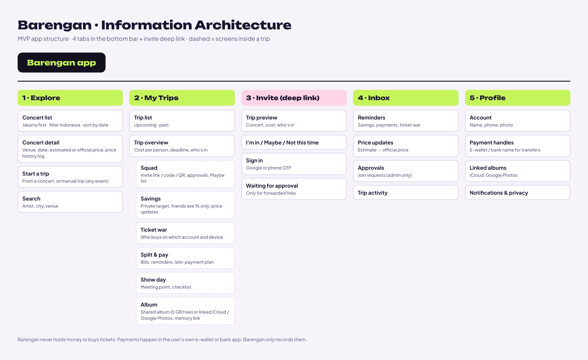
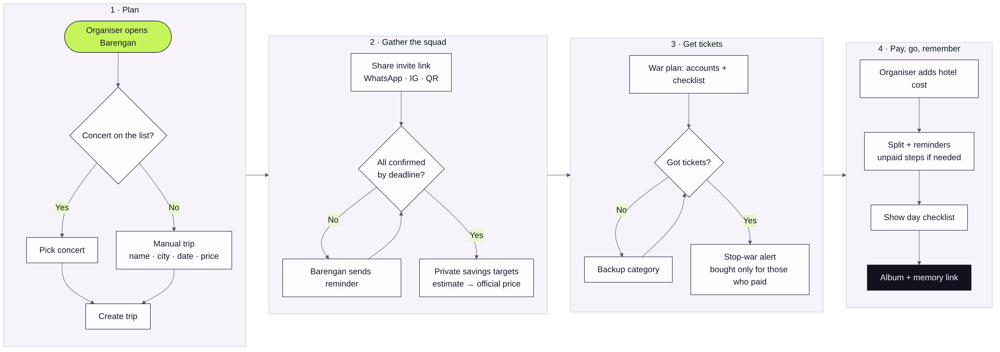
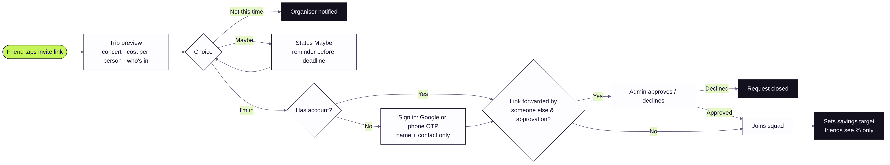
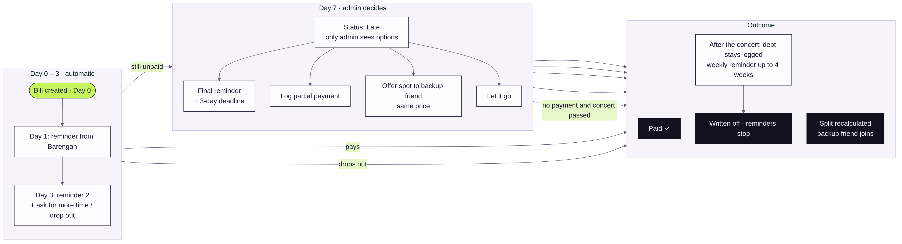
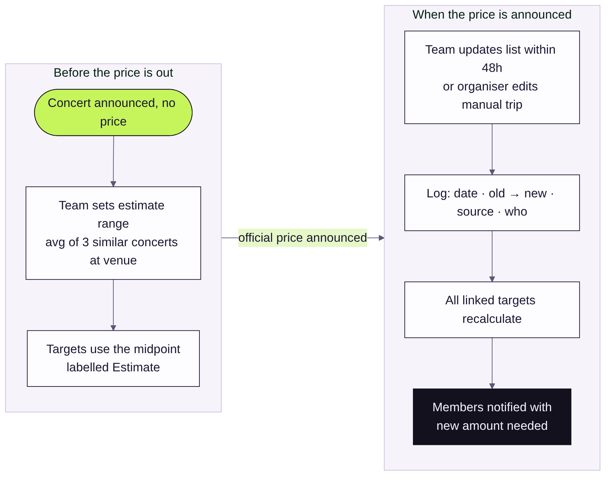
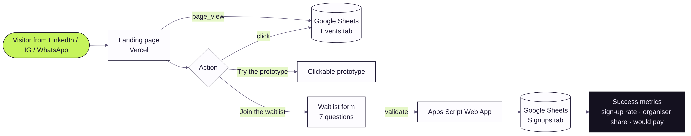
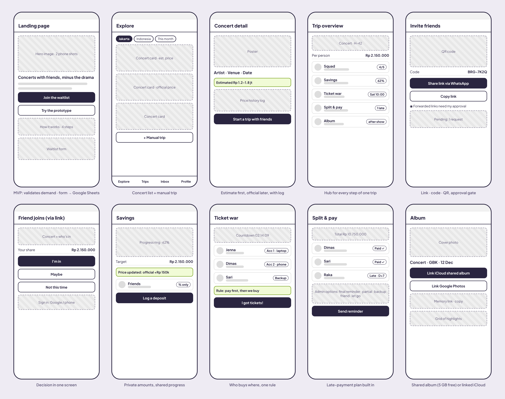

# Barengan · Product Requirements Document (MVP)

| | |
|---|---|
| **Product** | Barengan: a planner for friends going to concerts together |
| **Author** | Jenna Gozali (PM / BA) |
| **Status** | v1.0 · Final Project Checkpoint 2 · November 2026 |
| **Type** | Option B: 100% new digital product |
| **Links** | Live MVP: https://barengan-prototype.vercel.app · Repo: https://github.com/jennagozalii/barengan-prototype · Prototype: `/prototype/` · Case study: `/case-study/` |

---

## 1. Summary

Barengan helps a group of friends go to a concert together, from "who's in?" to the shared album after the show. One organiser (the "admin") creates a trip from a concert list or manually, invites friends with a link, and Barengan handles the parts that usually live in a messy group chat: confirming who's in, saving towards an estimated price that updates when the official price is out, planning the ticket war, splitting costs with reminders sent by the app, and collecting photos after the show.

Barengan never holds money and never buys tickets. Payments happen in the user's own e-wallet or bank app; Barengan only records them.

**Why it's new.** Ticket apps (Loket, Tiket.com, Ticketmaster) sell to one buyer. Split-bill apps (Splitwise, Patungan-style apps) start after the money is spent. Group chats have no structure. No product we found plans a group *before* the ticket sale opens and carries it through to the show.

## 2. Problem (from Part 2)

> Gen Z concert-goers in Jakarta who organise trips for their friends need a way to get everyone committed, saved up and paid on time, because today one person carries the planning, the risk of paying first and the awkward job of chasing money.

Key pain points from the Part 2 synthesis:
1. Commitment is vague ("liat nanti ya") until the ticket war, so the admin can't plan seats or hotels.
2. Friends don't save in time because the price isn't announced yet.
3. The ticket war is chaotic: no plan for who buys on which account.
4. The admin pays first and then chases friends for weeks.
5. Photos are scattered across everyone's phones after the show.

## 3. Brainstorming (product thinking)

**How might we…**
- HMW get friends to commit *before* the ticket sale?
- HMW help friends save when the price isn't known yet?
- HMW make the ticket war a plan instead of a panic?
- HMW get money back without the admin being "the debt collector"?
- HMW keep the memories in one place after the show?

**Ideas generated (16)** and what happened to them:

| # | Idea | Decision | Why |
|---|---|---|---|
| 1 | Trip with invite link + "I'm in / Maybe / Not this time" | ✅ MVP | Solves pain 1, low effort |
| 2 | Concert list with estimated → official price | ✅ MVP | Starting point + solves pain 2 |
| 3 | Private savings target, friends see % only | ✅ MVP | Solves pain 2 without money shame |
| 4 | Price history log | ✅ MVP | Trust when targets change |
| 5 | Ticket-war plan (accounts, devices, backups) | ✅ MVP | Solves pain 3, low effort |
| 6 | Auto split + reminders sent by the app | ✅ MVP | Solves pain 4 |
| 7 | Late-payment plan (Day 1/3/7 + admin options) | ✅ MVP | Lecturer edge case, solves pain 4 |
| 8 | Manual trip (any event, not in the list) | ✅ MVP | Coverage when a concert isn't listed |
| 9 | Shared album + iCloud / Google Photos link + memory link | ✅ MVP (Should) | Solves pain 5 |
| 10 | Show-day meeting point + checklist | ⏳ Later | Nice, not core to validation |
| 11 | WhatsApp bot instead of an app | ❌ | WA API cost/limits; no structured screens |
| 12 | Auto-buy bot for the ticket war | ❌ | Breaks ticketing T&C, unfair, legal risk |
| 13 | Barengan holds the money (escrow / installments) | ❌ | Needs OJK licence; too risky for MVP |
| 14 | Match with strangers to fill a squad | ❌ | Safety and trust issues; different product |
| 15 | Merch group order | ⏳ Later | Different job, extra logistics |
| 16 | Carpool / hotel booking inside the app | ⏳ Later | Partnerships needed; link out instead |

**Impact vs effort:** quick wins (high impact, low effort) were 1, 3, 5, 6, 8. Big bets (high impact, higher effort) were 2, 7, 9. Ideas 11–14 were dropped for cost, legal or safety reasons, not only effort.

## 4. Solution selection

We chose an **end-to-end trip planner** over two alternatives:

| Option | Pros | Cons | Verdict |
|---|---|---|---|
| A. Split-bill add-on only | Simple | Starts too late; copies Splitwise | ❌ |
| B. Ticket-war helper only | Exciting | Used once per trip; no retention | ❌ |
| **C. Trip planner (invite → save → war → split → album)** | Covers the whole job; one trip = many touchpoints | More scope | ✅ with a strict MVP scope |

RICE (from Checkpoint 1) put invites, savings and split at the top, which became the MVP core.

### MVP scope (MoSCoW)

| Must | Should | Could | Won't (now) |
|---|---|---|---|
| Concert list (Jakarta + Indonesia) | Price history log | Show-day checklist | Holding money / escrow |
| Manual trip | Shared album + iCloud link | Merch group order | Auto-buy bots |
| Invite via link / code / QR + approval | Ticket-war plan | Carpool links | Stranger matching |
| I'm in / Maybe / Not this time | Memory link | | Selling tickets |
| Private savings target (estimate → official) | | | |
| Split + reminders + late-payment plan | | | |

## 5. Users

| Persona | Job to be done |
|---|---|
| **Nadia, the organiser (22, Jakarta)** | "When a concert is announced, I want to know who's really in and get everyone's money in on time, so I don't end up paying for everyone." |
| **Raka, the friend who joins (23)** | "When my friend invites me, I want to see what it costs and when to pay, so I can decide quickly and not feel chased." |

## 6. Information architecture

Four tabs (Explore, My Trips, Inbox, Profile) plus the invite deep link. Everything for one trip lives inside the trip: Squad, Savings, Ticket war, Split & pay, Show day, Album.

## 7. User flows

**7.1 Main flow (organiser):** plan → gather the squad → get tickets → pay, go, remember.

**7.2 Friend joins via an invite link.** Forwarded links need the admin's approval.

**7.3 Edge case: a friend never pays.**

**7.4 Price: estimate → official → history log.**

**7.5 MVP (landing page) flow.**

## 8. Wireframes (low fidelity)

High-fidelity screens: the clickable prototype at `/prototype/`.

## 9. User stories and acceptance criteria

| ID | User story | Priority |
|---|---|---|
| US-01 | As an organiser, I want to browse concerts in Jakarta and Indonesia, so I can start a trip quickly. | Must |
| US-02 | As an organiser, I want to create a manual trip, so I can plan events that aren't in the list. | Must |
| US-03 | As an organiser, I want to invite friends with a link, code or QR, so they can join without searching for me. | Must |
| US-04 | As an organiser, I want to approve people who join through a forwarded link, so strangers can't join my trip. | Must |
| US-05 | As a friend, I want to see the concert and my cost before I answer, so I can decide quickly. | Must |
| US-06 | As a friend, I want to answer "Maybe", so I don't have to commit before I know. | Must |
| US-07 | As a member, I want a savings target based on the estimated price, so I can start saving before the price is out. | Must |
| US-08 | As a member, I want my target to update when the official price is out, and to see what changed. | Must |
| US-09 | As a member, I want friends to see only my % saved, not my amounts. | Must |
| US-10 | As an organiser, I want to assign who buys on which account and device, so the ticket war is a plan. | Should |
| US-11 | As an organiser, I want costs split automatically and reminders sent by Barengan, so I'm not the one chasing. | Must |
| US-12 | As an organiser, I want clear options when a friend still hasn't paid after 7 days. | Must |
| US-13 | As a member, I want one shared album and a memory link after the show. | Should |
| US-14 | As a visitor, I want to join the waitlist in under a minute, so I hear when Barengan launches. (MVP landing page) | Must |

**Acceptance criteria (Given / When / Then)**

**US-03 Invite**
- Given I created a trip, when I tap Invite, then I see a share link, a 6-character code and a QR code.
- Given I tap "Share via WhatsApp", then WhatsApp opens with a message that includes the concert name, cost per person and the link.
- Given the trip is full, when someone opens the link, then they see "This trip is full" and can ask to be on the backup list.

**US-04 Approval**
- Given "Forwarded links need my approval" is on, when someone opens a link that I didn't send to them directly, then they see "Waiting for approval" and I get a request in Inbox.
- Given I decline, then the requester sees "Request not approved" and is not added.

**US-05 / US-06 Friend decision**
- Given I open an invite link, then I see the concert, date, cost per person and who's in, before signing in.
- When I tap "I'm in", then I'm asked to sign in (Google or phone OTP) and I'm added to the squad.
- When I tap "Maybe", then I'm listed as Maybe and get a reminder 2 days before the commit deadline.
- When I tap "Not this time", then the organiser is notified and I'm not asked again for this trip.

**US-07 / US-08 Price**
- Given the official price isn't out, then the price shows "Estimated" with a range, and my target uses the upper end.
- When the official price is published, then my target updates, I get a notification "Price updated: +Rp150,000", and the change is added to the price history log with date, old price, new price and source.
- Given I open the price history, then I see every change in date order and nothing can be deleted.

**US-09 Privacy**
- Given I'm saving, then other members see only my progress %, never my amounts or deposits.

**US-11 Split and reminders**
- Given the organiser enters a cost and who it's for, then each person's share is calculated (rounded up to the nearest Rp1,000) and shown on their screen with the payee's e-wallet or bank name.
- Given a share is unpaid, then Barengan sends a reminder on Day 1 and Day 3 in Barengan's name.
- When a member taps "I've paid", then the organiser confirms it before the status turns Paid.

**US-12 Late payment**
- Given a share is still unpaid on Day 7, then the status turns Late and only the organiser sees four options: final reminder with a 3-day deadline, log a partial payment, offer the spot to a backup friend at the same price, or let it go.
- Given the concert has passed and the share is still unpaid, then the debt stays logged and a weekly reminder is sent for up to 4 weeks, then it's written off and reminders stop.
- Late status is never shown to other members.

**US-13 Album**
- Given the show date has passed, then the Album tab opens with a shared album (5 GB free per trip) and buttons to link an iCloud shared album or Google Photos album.
- When I tap "Copy memory link", then a read-only link to the album is copied.

**US-14 Waitlist (MVP landing page)**
- Given I fill in name, email, city, concerts per year, role, biggest pain and would-pay, and tick consent, when I tap "Join the waitlist", then my answers are added as a new row in the Google Sheet "Signups" within 5 seconds and I see a thank-you message.
- Given a required field is empty or the email is invalid, then the form doesn't submit and shows what to fix.
- Given a bot fills the hidden field, then nothing is saved.

## 10. Business rules

1. Barengan never holds money, buys tickets or resells tickets.
2. Free plan: up to 5 friends per trip and a 5 GB album. Barengan+ (Rp25,000 per group per concert): unlimited friends, scheduled reminders, receipts, 50 GB album.
3. Only the organiser sees Late status and the late-payment options.
4. Price changes are logged permanently (no edits, no deletes).
5. Forwarded invite links require approval when the setting is on (default on).
6. Reminders are sent at most once per day per person per trip.

## 11. Data model (simplified)

| Entity | Key fields |
|---|---|
| User | id, name, phone/email, payment_handle |
| Concert | id, artist, venue, city, date, price_status (estimated/official), price_min, price_max |
| PriceLog | id, concert_id, old_price, new_price, source, changed_at |
| Trip | id, concert_id or manual_title, organiser_id, commit_deadline, approval_required |
| Membership | trip_id, user_id, status (in/maybe/out/pending), role (admin/member/backup) |
| SavingsGoal | membership_id, target, saved_amount (private), percent (shared) |
| WarPlan | trip_id, user_id, account_label, device, role |
| Bill / Share | bill_id, trip_id, item, total, payer_id; share: user_id, amount, status (unpaid/paid/late/partial/written_off) |
| Reminder | share_id, type, sent_at |
| Album | trip_id, storage_used, external_link, memory_link |

## 12. Non-functional requirements

- Mobile first; landing page works at 360px width and loads in under 3 seconds on 4G.
- Privacy: savings amounts and late status are private; waitlist data is used only for launch updates (consent required).
- Accessibility: labels on every form field, colour contrast AA, keyboard friendly.
- Security: form has a honeypot and formula-injection guard; the Apps Script only appends rows.

## 13. MVP execution (landing page)

**Goal:** validate that Gen Z concert-goers want a group planner, that organisers are the right first user, and that groups would pay.

| Part | Tool |
|---|---|
| Copy, layout and code | Claude (LLM), built by prompting and iterating |
| Hosting | Vercel (auto-deploys from GitHub) |
| Source | GitHub: `jennagozalii/barengan-prototype` |
| Backend | Google Sheets + Google Apps Script web app |
| Tracking | Events tab in the same Sheet (page_view, form_start, click_prototype, click_case_study) |

How the form reaches Google Sheets: the browser sends the answers as JSON to the Apps Script web app URL → `doPost()` appends a row to the **Signups** tab (or **Events** for clicks) → the organiser reads results directly in the Sheet.

### Success metrics (first 14 days after launch)

| Metric | Formula (from the Sheet) | Target | Why |
|---|---|---|---|
| **Waitlist sign-ups** (North Star for MVP) | rows in Signups | ≥ 100 | Enough demand to build |
| Visitor → sign-up conversion | signups ÷ unique sessions with page_view | ≥ 20% | Message–market fit |
| Organiser share | role = organiser ÷ signups | ≥ 40% | Confirms our first user |
| Willingness to pay | (Yes + Maybe) ÷ signups | ≥ 30% | Barengan+ is viable |
| Prototype click-through | sessions with click_prototype ÷ sessions | ≥ 30% | Interest in the product, not only the idea |
| Qualitative feedback | rows with feedback | ≥ 20 | Input for the next iteration |
| Top pain point | most common biggest_pain | — | Which feature to build first |

**Decision rule:** if sign-ups ≥ 100 and conversion ≥ 20%, build the invite + savings + split beta. If conversion < 10%, rewrite the message and test again before building.

## 14. Risks and open questions

| Risk | Mitigation |
|---|---|
| Friends don't want "another app" | Invite works from a link without installing; WhatsApp sharing |
| Concert data goes out of date | Organisers can add a manual trip; price log shows source |
| Users expect Barengan to hold money | Clear "we never hold money" copy everywhere |
| Ticket-war rules from promoters change | Plan screen is generic (accounts, devices), no automation |

Open questions: will promoters partner on official price feeds? Is Rp25,000 per group the right price?

## 15. Release plan

| Phase | When | What |
|---|---|---|
| 0 · MVP landing page | Now (Nov 2026) | Waitlist + prototype, measure demand |
| 1 · Closed beta | +6 weeks | Invite, squad, savings, split, reminders (Must) |
| 2 · Public beta | +12 weeks | Ticket war, price log, album (Should) |
| 3 · Barengan+ | +16 weeks | Paid plan |
