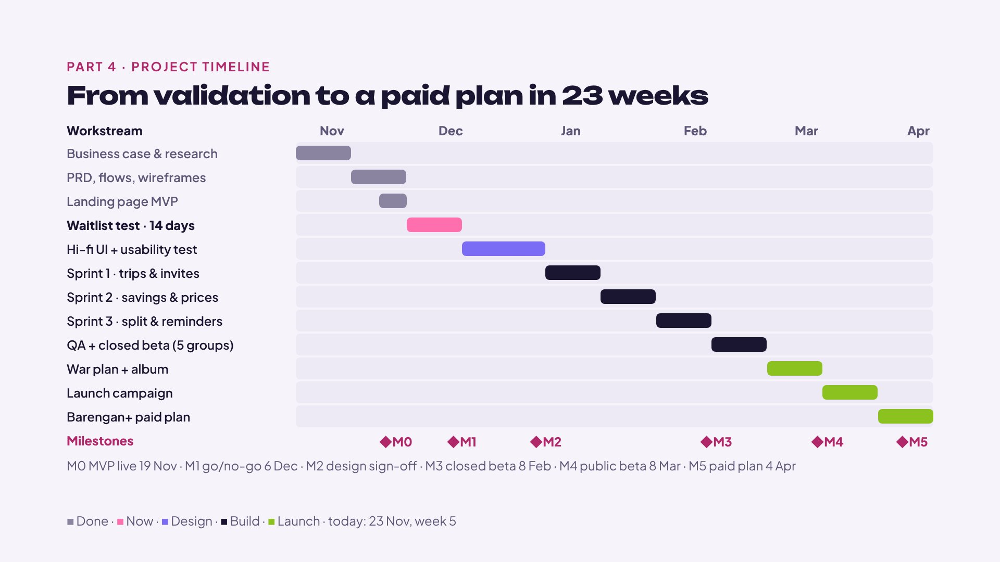
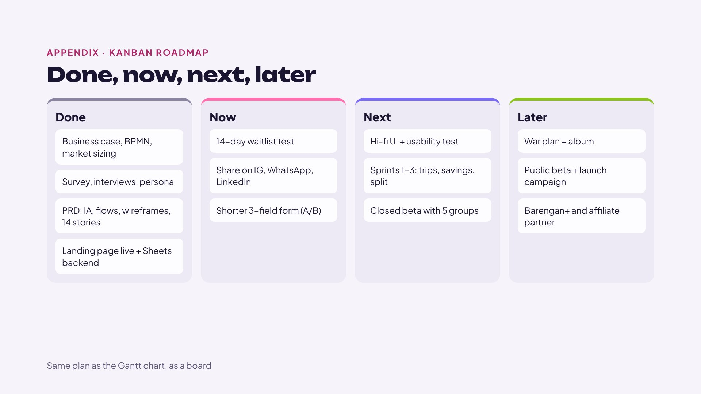
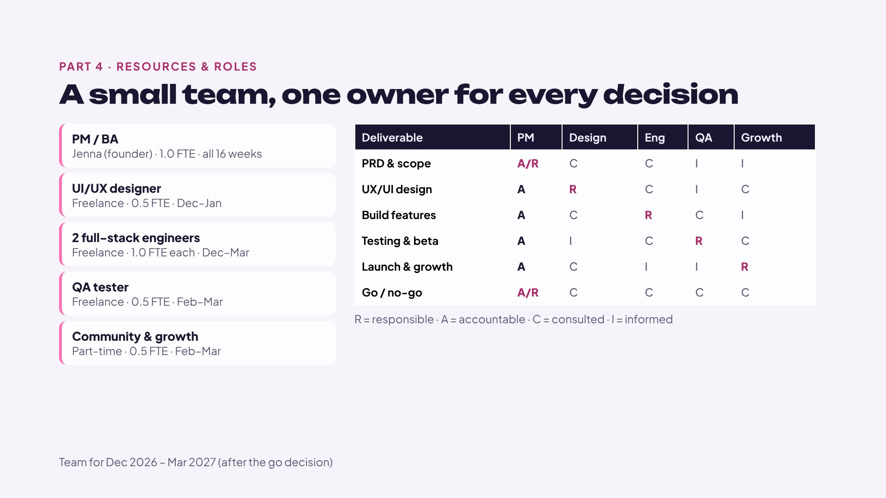
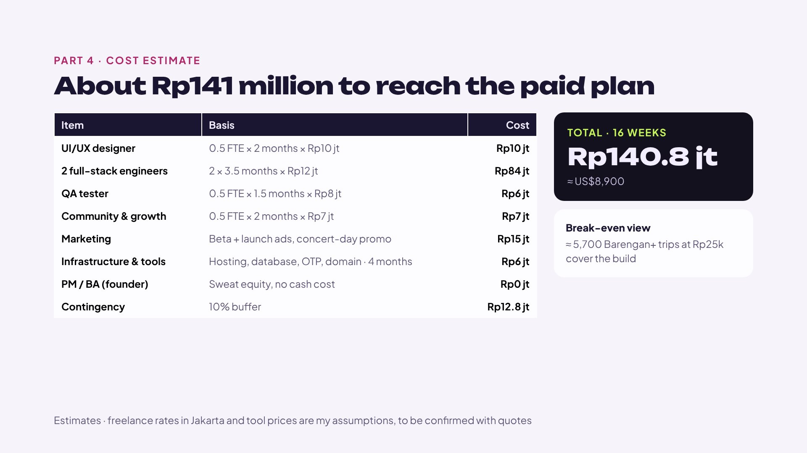
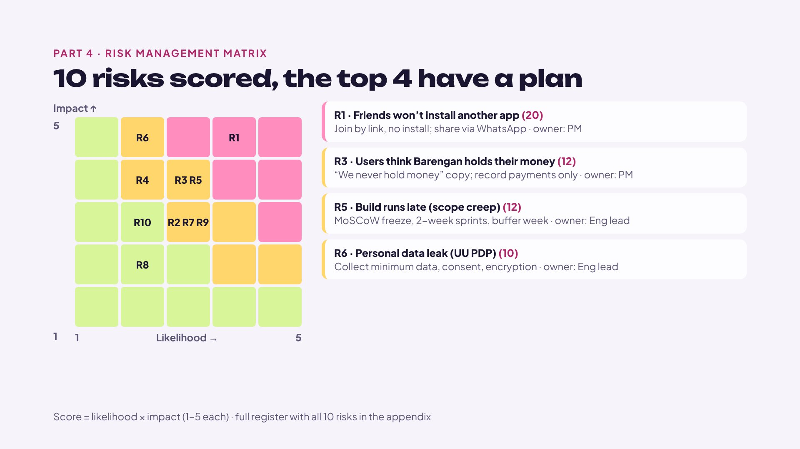

# Barengan · Project Plan (Part 4)

How Barengan goes from a validated landing page to a paid plan: timeline, milestones, team, budget and risks.
All costs and dates are estimates.

## 1. Timeline (Gantt)

| Phase | Workstream | Dates | Status |
|---|---|---|---|
| 0 · Validation | Business case & research | 26 Oct – 8 Nov 2026 | Done |
| | PRD, flows, wireframes | 9 – 22 Nov | Done |
| | Landing page MVP + Google Sheets | 16 – 22 Nov | Done (live 19 Nov) |
| | Waitlist test · 14 days | 23 Nov – 6 Dec | Now |
| 1 · Design | Hi-fi UI + usability test (5 users) | 7 – 27 Dec | Next |
| 2 · Build | Sprint 1: sign-in, trips, invites | 28 Dec – 10 Jan 2027 | |
| | Sprint 2: savings + price log | 11 – 24 Jan | |
| | Sprint 3: split, reminders, late-payment plan | 25 Jan – 7 Feb | |
| | QA + closed beta with 5 friend groups | 8 – 21 Feb | |
| 3 · Launch | Ticket-war plan + album | 22 Feb – 7 Mar | |
| | Launch campaign | 8 – 21 Mar | |
| 4 · Monetise | Barengan+ paid plan | 22 Mar – 4 Apr | |

## 2. Milestones

| ID | Milestone | Date | What has to be true |
|---|---|---|---|
| M0 | MVP live | 19 Nov 2026 | Landing page live, form writes to Google Sheets |
| M1 | Go / no-go | 6 Dec 2026 | ≥ 100 sign-ups and ≥ 20% conversion, or a clear reason to iterate |
| M2 | Design sign-off | 27 Dec 2026 | 5 usability tests, no blocking issue in invite → save → split |
| M3 | Closed beta | 8 Feb 2027 | All Must stories pass their acceptance criteria |
| M4 | Public beta | 8 Mar 2027 | 5 beta groups reach "fully ready"; crash-free sessions ≥ 99% |
| M5 | Barengan+ | 4 Apr 2027 | Paid plan live; first 50 paying groups |

## 3. Kanban roadmap

## 4. Resources and roles

| Role | Who | Load |
|---|---|---|
| PM / BA | Jenna (founder) | 1.0 FTE, all 16 weeks |
| UI/UX designer | Freelance | 0.5 FTE, Dec – Jan |
| 2 full-stack engineers | Freelance | 1.0 FTE each, Dec – Mar |
| QA tester | Freelance | 0.5 FTE, Feb – Mar |
| Community & growth | Part-time | 0.5 FTE, Feb – Mar |

**RACI** (R = responsible, A = accountable, C = consulted, I = informed)

| Deliverable | PM | Design | Eng | QA | Growth |
|---|---|---|---|---|---|
| PRD & scope | A/R | C | C | I | I |
| UX/UI design | A | R | C | I | C |
| Build features | A | C | R | C | I |
| Testing & beta | A | I | C | R | C |
| Launch & growth | A | C | I | I | R |
| Go / no-go | A/R | C | C | C | C |

Ways of working: 2-week sprints, a sprint review with a live demo, and the risk register reviewed every sprint.

## 5. Budget

| Item | Basis | Cost |
|---|---|---|
| UI/UX designer | 0.5 FTE × 2 months × Rp10 jt | Rp10 jt |
| 2 full-stack engineers | 2 × 3.5 months × Rp12 jt | Rp84 jt |
| QA tester | 0.5 FTE × 1.5 months × Rp8 jt | Rp6 jt |
| Community & growth | 0.5 FTE × 2 months × Rp7 jt | Rp7 jt |
| Marketing | Beta + launch ads, concert-day promo | Rp15 jt |
| Infrastructure & tools | Hosting, database, OTP, domain · 4 months | Rp6 jt |
| PM / BA (founder) | Sweat equity | Rp0 |
| Contingency | 10% | Rp12.8 jt |
| **Total** | **16 weeks** | **Rp140.8 jt (≈ US$8,900)** |

About 5,700 Barengan+ trips at Rp25,000 cover the build cost.

## 6. Risk management matrix

| ID | Risk | L | I | Score | Mitigation | Owner |
|---|---|---|---|---|---|---|
| R1 | Friends won't install another app | 4 | 5 | 20 | Join by link, no install; share via WhatsApp | PM |
| R3 | Users think Barengan holds their money | 3 | 4 | 12 | "We never hold money" copy; record payments only | PM |
| R5 | Build runs late (scope creep) | 3 | 4 | 12 | MoSCoW freeze, 2-week sprints, buffer week | Eng lead |
| R6 | Personal data leak (UU PDP) | 2 | 5 | 10 | Collect minimum data, consent, encryption | Eng lead |
| R2 | Concert and price data go out of date | 3 | 3 | 9 | Manual trips; price log shows source and date | PM |
| R7 | Groups won't pay for Barengan+ | 3 | 3 | 9 | Test price in waitlist; affiliate income | PM |
| R9 | Depends on one founder | 3 | 3 | 9 | Docs in GitHub + PRD; freelancers onboard fast | PM |
| R4 | Ticketing platforms change war rules | 2 | 4 | 8 | Generic war plan, no automation | PM |
| R10 | Budget overrun | 2 | 3 | 6 | 10% contingency; weekly burn check | PM |
| R8 | Reminders feel like spam | 2 | 2 | 4 | Max 1 reminder a day; users can mute | Design |

L = likelihood, I = impact (1–5). Score = L × I: 15+ high, 8–14 medium, under 8 low.
